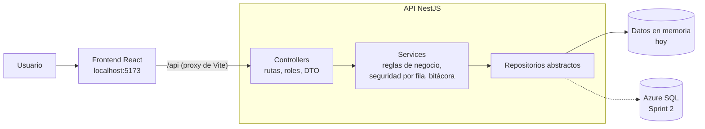

# FEMSA Auditoría Interna — Equipo 2 "Mesa para 7"

Plataforma web que sustituye a **Archer IRM** en la Dirección de Auditoría Interna de FEMSA. Es parte del proyecto *Ecosistema de Gestión de Datos e Insights para Auditoría Interna*. El Equipo 2 desarrolla tres etapas del ciclo de auditoría:

| Etapa | Qué cubre |
|---|---|
| **Ejecución** | Evaluación de controles, solicitudes de información (PBC), evidencias y registro de hallazgos |
| **Cierre** | Validación de pre-cierre, cadena de firmas Jefe → Gerente → Director y sellado inmutable del expediente |
| **Seguimiento** | Planes de remediación, avances con semáforo, validación de Control Interno (GRC) y alertas |

Quedan fuera del alcance (salvo dependencias): la planeación anual y trimestral, la administración de la plataforma y el diseño gráfico final.

> **Proyecto en desarrollo · copia de portafolio.** Este repositorio contiene solo el código del proyecto (frontend, API y modelo SQL con datos de demostración), publicado por Carlos Baranda para mostrar su trabajo. No incluye documentos internos ni material entregado por FEMSA. No es un producto oficial de FEMSA. El repositorio de trabajo del equipo es privado.

---

## Tecnologías

| Capa | Tecnología |
|---|---|
| Frontend | React 19 · Vite 8 · Tailwind CSS 4 · React Router 8 |
| Backend | NestJS 12 · TypeScript 5.9 · class-validator · Swagger (OpenAPI) |
| Datos | En memoria (desarrollo) → Azure SQL Database / SQL Server 2022 (esquema `aud`, v2.1) |
| Pruebas | Jest 30 + Supertest (backend) · Oxlint (frontend) |
| Nube objetivo | Microsoft Azure: App Service, Azure SQL, Blob Storage, Entra ID (SSO) |
| Gestión | Jira (proyecto FE1S, Scrum) · GitHub |

## Inicio rápido

**Requisito:** Node.js 20.11 o superior. No hace falta base de datos: la API trabaja con datos de demostración en memoria, que se reinician cada vez que la levantas.

```bash
git clone https://github.com/iSyncs/Femsa-equipo-2.git
cd Femsa-equipo-2
```

**Terminal 1 · API**

```bash
cd backend
npm install
npm run dev
```

**Terminal 2 · Frontend**

```bash
cd frontend
npm install
npm run dev
```

| Qué | Dónde |
|---|---|
| Aplicación | http://localhost:5173 |
| API | http://localhost:4000/api |
| Documentación de la API (Swagger) | http://localhost:4000/api/docs |

### Acceso de demostración

Por ahora no hay pantalla de inicio de sesión: al abrir la app se entra automáticamente con la cuenta de **José Martínez** (Auditor Líder · Retail & Spin) mediante `POST /api/sesion/demo`. El inicio de sesión con correo y contraseña sigue disponible en la API (`POST /api/sesion`, contraseña en `DEMO_PASSWORD`) para cuando se habilite la pantalla o Entra ID.

José es líder de cinco auditorías de ejemplo (prevención de lavado de dinero en Spin, manejo de efectivo en OXXO, conflictos de interés en FEMSA Servicios, respaldos en Valora y reporte ESG), con procedimientos, hallazgos, evidencias, planes y una cadena de firmas en curso. Los demás usuarios de los datos de demostración (jefes, gerentes, director, GRC y auditados) siguen existiendo para las firmas y las pruebas e2e, pero no tienen contraseña y no pueden iniciar sesión.

### Comandos útiles

| Carpeta | Comando | Qué hace |
|---|---|---|
| `backend/` | `npm run dev` | API con recarga automática |
| `backend/` | `npm test` | Pruebas unitarias |
| `backend/` | `npm run test:e2e` | Pruebas de punta a punta de la API |
| `backend/` | `npm run build` | Compila a `dist/` |
| `frontend/` | `npm run dev` | App con recarga automática |
| `frontend/` | `npm run build` | Build de producción |
| `frontend/` | `npm run lint` | Revisión de código con Oxlint |

## Arquitectura



- **El navegador nunca ve credenciales:** solo habla con `/api`.
- **Seguridad:** cada ruta declara sus roles (`@Roles`) y cada consulta filtra por fila. El Director ve todo; el auditado, solo sus auditorías; GRC, su unidad de negocio; los demás, su Dirección (Bebidas o Retail & Spin).
- **Validación:** los campos obligatorios exigen texto real, no solo "no vacío". Se valida en el frontend, en la API y en la base de datos.
- **Trazabilidad:** cada operación quedará en una bitácora de solo agregar, con fecha en UTC y la zona horaria del usuario (HU_15).
- **Inmutabilidad:** al cerrar, el expediente se sella con un hash SHA-256 que se puede verificar en cualquier momento.

## Historias de usuario y estado

Backlog en Jira: **15 historias, 70 story points**. Estado al 5 de octubre de 2026:

| HU | Historia | Módulo backend | Estado |
|---|---|---|---|
| HU_01 | Sesión, roles y seguridad por fila (SSO Entra ID) | `auth/`, `sistema/` | Base lista con correo y contraseña; falta Entra ID |
| HU_02 | Evaluación de controles | `auditorias/` | Listo (Jorge) |
| HU_03 | Evidencias en Azure Blob Storage | `evidencias/` (por crear) | Sprint 2 |
| HU_04 | Registro de hallazgos | `hallazgos/` | Listo |
| HU_05 | Solicitudes de información (PBC) | `pbc/` (por crear) | Pendiente |
| HU_06 | Validación de pre-cierre | `cierre/` | Listo |
| HU_07 | Aprobación multinivel | `cierre/` | Listo |
| HU_08 | Bloqueo post-cierre y sellado SHA-256 | `cierre/` | Listo |
| HU_09 | Alta de planes de remediación | `planes/` | Listo (Emilio) |
| HU_10 | Avances y semáforo | `planes/` | Listo |
| HU_11 | Validación GRC → Jefatura | `planes/` | Listo (Manuel) |
| HU_12 | Notificaciones 15/5/1 días | `notificaciones/` (por crear) | Pendiente |
| HU_13 | Informe ejecutivo en PDF | `reportes/` | Sprint 2 |
| HU_14 | Tableros (Dashboard) | `reportes/` | Listo (Héctor) |
| HU_15 | Bitácora de accesos y operaciones | `bitacora/` | Listo (Gabriel) |

Las pantallas cuya API todavía no existe muestran el aviso **"Módulo en desarrollo"**. La guía paso a paso para agregar una historia está en [backend/README.md](backend/README.md#cómo-agregar-una-historia-nueva-ejemplo-hu_05-solicitudes-pbc).

## Cronograma

| Sprint | Fechas | Objetivo |
|---|---|---|
| Sprint 0 | 10-ago → 11-sep | Propuesta y planeación |
| Sprint 1 | 21-sep → 2-oct | Inicio del desarrollo |
| **Sprint 2** | 5 → 16-oct | Producto mínimo viable *(actual)* |
| Sprint 3 | 19-oct → 6-nov | Funcionamiento de IA |
| Sprint 4 | 9 → 20-nov | Prototipo |
| Sprint 5 | 23-nov → 4-dic | Entrega final |

## Equipo

| Integrante | Rol |
|---|---|
| Carlos Baranda | Scrum Master · versión inicial (React, NestJS, modelo SQL), inicio de sesión, despliegue y dashboard |
| Héctor Pablo González Espinosa | Product Owner · tableros (HU_14) |
| Jorge Eduardo García Pereda | Developer · evaluación de controles (HU_02) |
| Emilio Salas Porras | Developer · alta de planes de remediación (HU_09) |
| Sebastián Sánchez | Developer |
| Manuel Alejandro Cruz Valladares | Developer · validación GRC (HU_11) |
| Gabriel Junco de la Vega Fernández | Developer · bitácora (HU_15) |

Tecnológico de Monterrey · Planeación de Sistemas de Software · 2026
